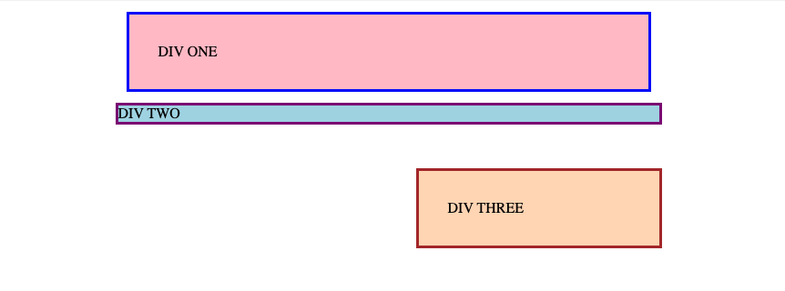

# Margin and Padding practice

For this first exercise, simply edit the `style.css` file so that the divs look like the image below. Only edit the CSS where instructed in the file.  You should only have to change the values of the margin and padding for this exercise. You should not have to add or remove properties in the CSS, or touch the HTML.

### Self-check 
Use this section to check your work. On _these_ projects, your goal isn't to attain 100% pixel perfection, but to use the tools you've learned to get relatively close to the desired output.

- Div One and Div Three have 32px between their text and border.
- Div One has 12px between it and any other element on the page.
- There is a 48px gap between Div Two and Div Three.
- Div Three is aligned to the right.
- Div Three's alignment is achieved using `margin` (and not float, flexbox, etc.).
--------------------------------------------------------------------------

# Prática de Margin e Padding

Para este primeiro exercício, basta editar o arquivo `style.css` para que as `divs` fiquem como na imagem abaixo. Edite o CSS apenas nos locais indicados no arquivo. Para este exercício, você só precisa alterar os valores de `margin` e `padding`. Não é necessário adicionar ou remover propriedades no CSS, nem alterar o HTML.

### Verificação
Use esta seção para conferir o seu trabalho. Nestes projetos, o objetivo não é alcançar uma precisão de 100% (pixel-perfect), mas sim utilizar as ferramentas que você aprendeu para chegar a um resultado bem próximo ao esperado.

- A "Div One" e a "Div Three" possuem 32px de espaçamento entre o texto e a borda.
- A "Div One" possui 12px de espaçamento em relação a qualquer outro elemento na página.
- Há um espaçamento de 48px entre a "Div Two" e a "Div Three".
- A "Div Three" está alinhada à direita.
- O alinhamento da "Div Three" deve ser feito utilizando `margin` (e não `float`, `flexbox`, etc.).