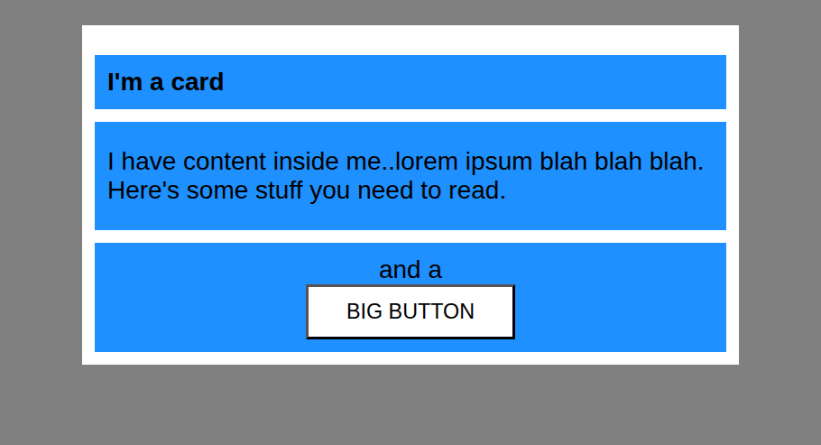

# Margin and Padding #2

This one is a little nicer looking, and a little closer to something you might see in the real world. You'll need to change a little more than just margin and padding to make it look exactly right.

## Desired outcome

### Self Check
Use this section to check your work. On _these_ projects, your goal isn't to attain 100% pixel perfection, but to use the tools you've learned to get relatively close to the desired output.

- Just as a reference, the font size in the desired outcome image is 16px. Aim to replicate the image *within reason*.
--------------------------------------------------------------

# Margem e Espaçamento (Margin e Padding) #2

Este exemplo tem uma aparência um pouco mais agradável e se aproxima mais do que você encontraria em um projeto real. Será necessário ajustar um pouco mais do que apenas as propriedades `margin` e `padding` para obter o resultado ideal.

## Resultado desejado

### Verificação
Use esta seção para conferir o seu trabalho. Nestes projetos, o objetivo não é alcançar uma precisão de 100% (pixel-perfect), mas sim utilizar as ferramentas que você aprendeu para chegar a um resultado bem próximo ao esperado.

- Apenas como referência: o tamanho da fonte na imagem de exemplo é de 16px. Tente reproduzir a imagem *dentro do razoável*.