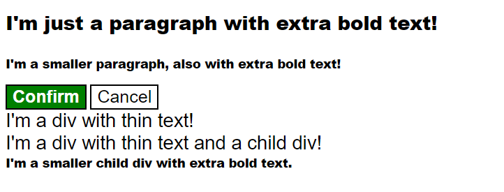

# CSS Methods

This next exercise for CSS Foundations is going to give you a closer look at the cascade, in particular specificity and rule order. Both the HTML and CSS files are filled out for you, so instead of adding rules yourself, you will simply be editing what is provided.

There are a few elements that have some sort of specificity or rule order issue in the provided CSS file. It's up to you to figure out what issue is affecting an element, and how to fix it. You can edit the CSS file by adding, removing, or editing selectors for a declaration block, or by moving declaration blocks around. **You should not edit the HTML file or any of the actual styles in the CSS**.

There are multiple ways to solve this exercise, so we have provided some of the possible solutions for each element.

Issues with the cascade can be the bane of their existence for many when it comes to CSS. While you won't become a cascade expert from this exercise alone, and there are other ways to deal with these issues, it is still super helpful to see how these issues affect our final styles and why it's important to order rules carefully.

## Desired Outcome

### Self Check

- Did you make sure to not edit the HTML file?
- If you added selectors to the CSS, do they target a valid HTML element?
---------------------------------------------------------------------------------------------------------------------------------------------------------------------------------------------------------------------------------------------------------------------------------
# Métodos de CSS

Este próximo exercício sobre os fundamentos do CSS permitirá que você analise mais de perto o conceito de *cascade* (cascata), especificamente a especificidade e a ordem das regras. Os arquivos HTML e CSS já estão preenchidos; portanto, em vez de adicionar novas regras, você deverá editar o conteúdo que já foi fornecido.

No arquivo CSS, há alguns elementos que apresentam problemas relacionados à especificidade ou à ordem das regras. Cabe a você identificar qual problema está afetando cada elemento e como corrigi-lo. Você pode editar o arquivo CSS adicionando, removendo ou alterando seletores em um bloco de declarações, ou ainda reorganizando a posição desses blocos. **Não altere o arquivo HTML nem os estilos propriamente ditos no CSS**.

Existem várias maneiras de resolver este exercício; por isso, apresentamos algumas das soluções possíveis para cada elemento.

Problemas com a *cascade* podem ser uma grande dor de cabeça para muitos ao trabalhar com CSS. Embora este exercício, por si só, não faça de você um especialista no assunto — e existam outras formas de lidar com essas questões —, é extremamente útil observar como tais problemas afetam o resultado final dos estilos e entender por que é fundamental definir a ordem das regras com cuidado.

## Resultado Esperado

### Verificação

- Você se certificou de não alterar o arquivo HTML?
- Se você adicionou seletores ao CSS, eles correspondem a um elemento HTML válido?