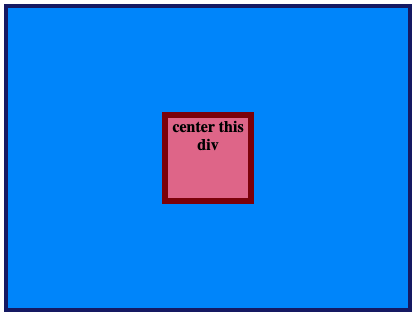

# CENTER THIS DIV
This one is simple, but it's something that you'll want to do ALL THE TIME.  Might as well get it out of the way now.

All you need to do is center the red div inside the blue container.

## Desired Outcome

### Self Check
- Is the red div centered?
- Did you _only_ use flexbox to center it?
-------------------------------------------------------------------------

# Centralize esta div
Isso é simples, mas é algo que você vai querer fazer o tempo todo. É melhor resolver logo de uma vez.

Tudo o que você precisa fazer é centralizar a div vermelha dentro do contêiner azul.

## Resultado esperado

### Verificação
- A div vermelha está centralizada?
- Você usou _apenas_ flexbox para centralizá-la?