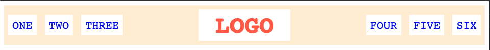
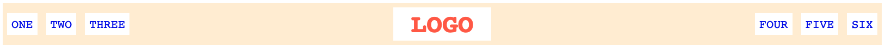

# A Basic Header

Use flexbox rules to create this very common webpage header style. The benefit to using flex here is that everything should be _flexible_. Check out the two screenshots below to get an idea of how it should scale with your screen. Besides flex rules, you'll also want to add some rules for margin and padding. (Hint: `ul`s have some default margin/padding that you will need to deal with.)

## Desired Outcome

narrow:

wide: 

### Self Check
- There is space between all items and the edge of the header (specific px amount doesn't matter here).
- Logo is centered vertically and horizontally.
- list-items are horizontal, and are centered vertically inside the header.
- left-links and right-links are pushed all the way to the left and right, and stay at the edge of the header when the page is resized.
- Your solution does not use floats, inline-block, or absolute positioning.

- Note: For this exercise, it's completely acceptable to not match the font-family.
-----------------------------------------------------------------------------

# Cabeçalho Básico

Utilize regras de *flexbox* para criar este estilo de cabeçalho de página web, que é bastante comum. A vantagem de usar *flex* neste caso é que todos os elementos se tornam _flexíveis_. Observe as duas capturas de tela abaixo para ter uma ideia de como o layout deve se ajustar conforme o tamanho da tela. Além das regras de *flex*, você também precisará definir propriedades de *margin* (margem) e *padding* (espaçamento interno). (Dica: elementos `ul` possuem margens e espaçamentos padrão que precisarão ser ajustados.)

## Resultado Esperado

tela estreita:

tela larga:

### Verificação
- Existe espaçamento entre todos os itens e as bordas do cabeçalho (o valor exato em pixels não é importante aqui).
- O logotipo está centralizado tanto vertical quanto horizontalmente.
- Os itens da lista (*list-items*) estão dispostos horizontalmente e centralizados verticalmente dentro do cabeçalho.
- Os links à esquerda e à direita estão posicionados, respectivamente, nas extremidades esquerda e direita, mantendo-se junto às bordas do cabeçalho mesmo quando a página é redimensionada.
- Sua solução não utiliza *floats*, *inline-block* ou posicionamento absoluto (*absolute positioning*).

- Observação: Para este exercício, não é necessário reproduzir a mesma família de fontes (*font-family*).