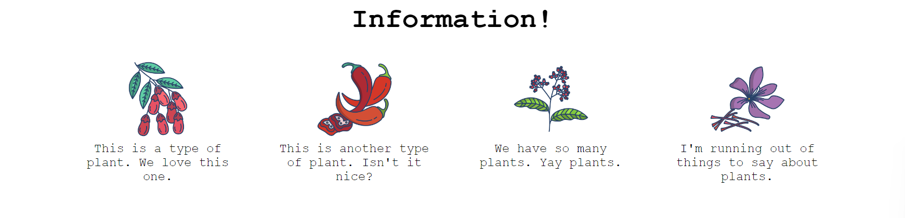

# A very common website feature

The goal of this exercise is to recreate a section that is found on many informational websites.

For this one you will need to edit the HTML a little bit too. We can't be making things _too_ easy for you. You'll want to add containers around the various elements so that you can flex them. Good luck!

## Desired outcome

### Self Check

- All items are centered on the page (horizontally, not vertically).
- The title is centered on the page.
- There is 32px between the title and the 'items.'
- There is 52px between each item.
- The items are arranged horizontally on the page.
- The items are only 200px wide and the text wraps.
- The item text is centered.
------------------------------------------------------------------------

# Um recurso de site muito comum

O objetivo deste exercício é recriar uma seção encontrada em muitos sites informativos.

Para este, você também precisará fazer algumas alterações no HTML. Não podemos deixar as coisas *fáceis demais* para você, certo? Você precisará adicionar contêineres ao redor dos diversos elementos para poder aplicar o layout flexível (flexbox). Boa sorte!

## Resultado esperado

### Verificação

- Todos os itens estão centralizados na página (horizontalmente, não verticalmente).
- O título está centralizado na página.
- Há um espaçamento de 32px entre o título e os "itens".
- Há um espaçamento de 52px entre cada item.
- Os itens estão dispostos horizontalmente na página.
- Os itens possuem uma largura de apenas 200px, e o texto quebra de linha.
- O texto dentro dos itens está centralizado.