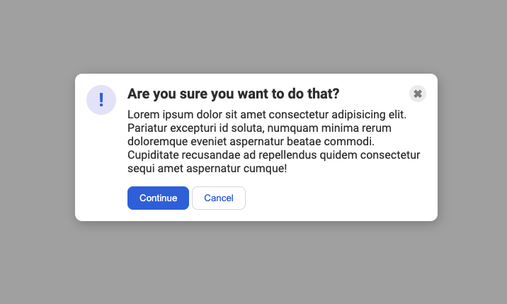

# A common 'modal' style
This one is another very common pattern on the web. The solution to this one is _simple_... but it might not be immediately obvious to you. You'll need to edit the HTML a bit to get everything where it needs to be.

### A hint
Depending on how you approach this one, you might need to revisit the `flex-shrink` property to keep a flex item from getting smashed. In addition, pay attention to the structure of the html, specifically look into adding an additional container surrounding the header, button, main text, cancel, and continue divs; and look into moving the header div to encompass the button as well.

## Desired outcome

### Self Check

- The blue icon is aligned to the left.
- There is equal space on either side of the icon (the gaps between the icon and the edge of the card, and the icon and the text, are the same).
- There is padding around the edge of the modal.
- The header, text, and buttons are aligned with each other.
- The header is bold and a slightly larger text-size than the text.
- The close button is vertically aligned with the header, and aligned in the top-right of the card.
-----------------------------------------------------------------

# Um estilo comum de "modal"
Este é mais um padrão bastante comum na web. A solução para ele é _simples_... mas talvez não seja imediatamente óbvia. Você precisará fazer alguns ajustes no HTML para colocar cada elemento no lugar certo.

### Uma dica
Dependendo da abordagem escolhida, talvez seja necessário rever a propriedade `flex-shrink` para evitar que um item flexível seja comprimido. Além disso, preste atenção à estrutura do HTML: considere adicionar um contêiner extra que envolva as divs do cabeçalho, botão, texto principal, "cancelar" e "continuar". Tente também ajustar a div do cabeçalho para que ela englobe, inclusive, o botão.

## Resultado esperado

### Verificação

- O ícone azul está alinhado à esquerda.
- Há um espaçamento igual em ambos os lados do ícone (o espaço entre o ícone e a borda do card é o mesmo que existe entre o ícone e o texto).
- Há um espaçamento interno (*padding*) ao redor das bordas do modal.
- O cabeçalho, o texto e os botões estão alinhados entre si.
- O cabeçalho está em negrito e possui um tamanho de fonte ligeiramente maior que o do texto principal.
- O botão de fechar está alinhado verticalmente com o cabeçalho e posicionado no canto superior direito do card.