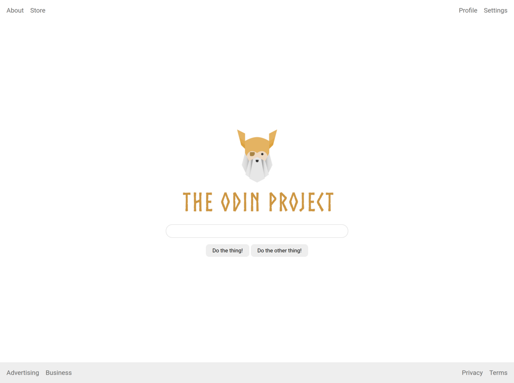

# An entire page!

Flexbox is useful for laying out entire pages as well as the smaller components we've already been working with. For this exercise, we're leaving you with a little more work to do, with some things you may not have encountered yet. It's perfectly acceptable to google things you're unsure of!

### Hints
- You may want to search something like `CSS remove list bullets`.  We've done this for you in previous examples, but not here. Yay learning.
- Finding out how to style links in CSS might help you get rid of that pesky underline decoration...
- We've added `height: 100vh` to the `body`... this makes the body exactly the same height as the viewport. To stick the footer to the bottom you will need to use flex and change the direction to column.

## Desired Outcome

### Self Check

- The header is at the top of the page, the footer is at the bottom, and they stay in place if you resize your screen.
- The header and footer have padding.
- The links in the header and footer are pushed to either side.
- There is space between the links in the header and footer.
- The footer has a light gray background (`#eeeeee`).
- The logo, input and buttons are centered in the screen.
- The buttons have an appropriate amount of padding.
- There is space between the logo, input and buttons.
----------------------------------------------------------------------------------------

# Uma página inteira!

O Flexbox é útil tanto para estruturar páginas completas quanto para organizar componentes menores, com os quais você já vem trabalhando. Neste exercício, propomos um desafio um pouco maior, incluindo elementos que talvez você ainda não conheça. Não há problema nenhum em pesquisar no Google caso surja alguma dúvida!

### Dicas
- Tente pesquisar algo como `CSS remove list bullets` (como remover marcadores de lista em CSS). Já fizemos isso por você em exemplos anteriores, mas agora é sua vez. Aproveite para aprender!
- Descobrir como estilizar links em CSS pode ajudar a remover aquele sublinhado indesejado...
- Adicionamos `height: 100vh` ao elemento `body`... isso faz com que ele tenha exatamente a mesma altura da área de visualização (viewport). Para fixar o rodapé na parte inferior, você precisará usar o Flexbox e definir a direção como coluna (`column`).

## Resultado esperado

### Verificação

- O cabeçalho está no topo da página, o rodapé na parte inferior, e ambos permanecem em suas posições mesmo ao redimensionar a tela.
- O cabeçalho e o rodapé possuem espaçamento interno (`padding`).
- Os links no cabeçalho e no rodapé estão posicionados nas extremidades (lados opostos).
- Existe espaçamento entre os links no cabeçalho e no rodapé.
- O rodapé possui um fundo cinza-claro (`#eeeeee`).
- O logotipo, o campo de entrada (`input`) e os botões estão centralizados na tela.
- Os botões possuem um espaçamento interno (`padding`) adequado.
- Existe espaçamento entre o logotipo, o campo de entrada e os botões.